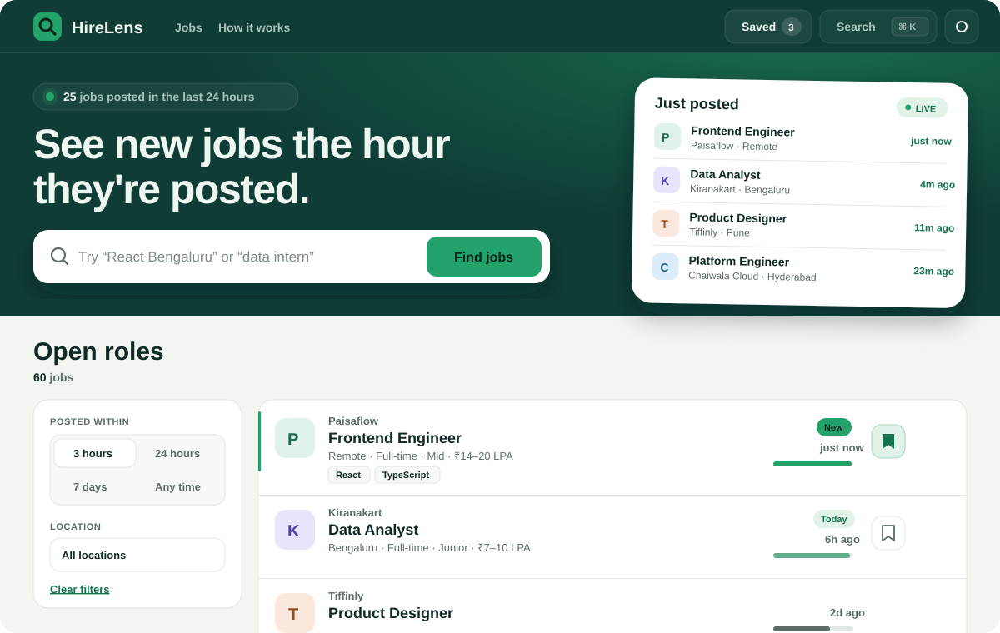

# HireLens

**See new jobs the hour they're posted.** HireLens is a fresh-first job discovery Progressive Web App for India's product companies, built with plain HTML, CSS and JavaScript modules. It has no framework, no build step and no runtime dependencies.

**Live demo:** https://YOUR-USERNAME.github.io/hirelens/



> **Note:** every company, role and salary in `data/jobs.json` is **mock data** made up for this demo. None of it is a real job posting.

## Features

### Core
- Newest jobs first, with a freshness bar and *New* / *Today* pills on every row
- Search that waits 250 ms after you stop typing and matches every word across title, company, location and skills
- Filters for location, job type, department and posted within (3h / 24h / 7d), plus sorting by newest or highest pay
- The current filters live in the URL (`history.replaceState`), so any view can be shared as a link
- Saved jobs stored in IndexedDB, with a localStorage fallback. The UI updates straight away and rolls back with a toast if the write fails
- *Saved* toggle in the nav with a live count and `aria-pressed`
- Infinite scroll in pages of 10 using `IntersectionObserver`
- Job details in a native `<dialog>`. Esc or a backdrop click closes it, and focus goes back to the button that opened it
- Relative times update every 60 seconds
- Light and dark themes that follow the system by default and remember your choice
- Skeleton loaders, an error state with *Try again*, and an empty state with *Clear filters*
- Offline support: a service worker serves the app shell cache-first and the data stale-while-revalidate, and a banner appears when you go offline

### Standout layer
1. **Motion system:** shared easing and duration tokens. Every animation turns into an instant change or a simple fade under `prefers-reduced-motion`.
2. **FLIP list animation:** when filters or sort change, rows slide to their new positions, removed rows fade and shrink out, and new rows rise in with a 28 ms stagger.
3. **View Transitions:** the theme toggle reveals the new theme in a circle from the button, and a row's logo morphs into the dialog header. Browsers without the API get the plain transition.
4. **Command palette** (`⌘K` / `Ctrl K`): fuzzy search over every job, commands grouped separately, full `aria-activedescendant` support.
5. **Keyboard-first list:** `j` / `k` move between rows, `Enter` opens, `s` saves, `/` focuses search, `?` opens the shortcut sheet, `Esc` closes any dialog.
6. **Compare drawer:** shortlist up to 3 jobs and see them side by side, with the best salary and the freshest posting highlighted. On mobile it becomes a bottom sheet.
7. **Deep links:** `?job=<id>` opens that job's dialog on a cold load. *Copy link* copies the job's full URL.
8. **Recently viewed:** a strip under the hero showing the last 6 jobs you opened.
9. **"New since your last visit"** banner that applies a 24-hour filter in one click.
10. **Animated numbers:** the hero count counts up, the saved badge pulses when it changes, the result count cross-fades, freshness bars fill when they scroll into view, and *hot* bars shimmer.
11. **Hover peek** (desktop only): after 350 ms on a row, a card shows the full summary, where the salary sits in its band, and the skills.
12. **Toasts:** up to 3 at once, each with an undo or retry action, a progress bar, and a timer that pauses on hover.
13. **Install prompt:** a custom *Install app* button and palette command.
14. **Scroll reveal** for sections, with numbered steps that stagger in.
15. **Shimmer skeletons:** no spinners anywhere.
16. **Hand-drawn inline SVG illustrations** for the empty and error states.
17. **Filter chips** you can remove one by one, with *Clear all* once there are two or more.
18. **Live pulse details:** a pulsing *Live* badge, an accent bar on hot rows, and a magnifier logo that scans on hover.

### Accessibility
Semantic landmarks, a skip link, a labelled control for every action, an `aria-live` result count, `aria-pressed` and `aria-expanded` where they apply, visible `:focus-visible` rings on every interactive element, focus kept inside each dialog, focus restored when it closes, and reduced motion respected everywhere.

## Keyboard shortcuts

| Key | Action |
| --- | --- |
| `⌘K` / `Ctrl K` | Command palette |
| `/` | Focus search |
| `j` / `k` | Next / previous job |
| `Enter` | Open focused job |
| `s` | Save or unsave focused job |
| `t` | Toggle theme |
| `x` | Clear filters |
| `v` | Show saved jobs |
| `p` / `n` | Sort by pay / newest |
| `l` | Copy link to this view |
| `?` | Shortcut sheet |
| `Esc` | Close any dialog |

## Tech stack

- HTML5 with native `<dialog>`, landmarks and ARIA
- CSS with custom properties, `color-mix()`, Grid and Flexbox layouts, View Transitions
- JavaScript ES modules with no third-party code
- IndexedDB, localStorage, sessionStorage
- Service Worker and Web App Manifest
- `node:test` for unit tests

## Project structure

```
hirelens/
├── index.html              App shell, dialogs and the SVG icon sprite
├── css/styles.css          Design tokens, motion system, components, responsive rules
├── js/
│   ├── main.js             State wiring, rendering, FLIP, dialogs, palette, keyboard, toasts
│   ├── store.js            Tiny observable store plus safe storage helpers
│   ├── db.js               Saved jobs in IndexedDB with a localStorage fallback
│   ├── render.js           HTML templates; every dynamic value goes through escapeHTML
│   └── utils.js            Pure, unit-tested helpers (filtering, time, URL, fuzzy match)
├── sw.js                   Versioned caches: cache-first shell, stale-while-revalidate data
├── manifest.webmanifest
├── data/jobs.json          60 mock jobs
├── assets/
│   ├── icon.svg
│   ├── preview.svg
│   └── fonts/              Self-hosted woff2, OFL licence, download notes
├── tests/utils.test.js     10 unit tests
├── package.json
├── LICENSE
└── README.md
```

## Run locally

ES modules and service workers need a real HTTP server. **Opening `index.html` directly as a `file://` URL will not work.**

```bash
npx serve .
python -m http.server 8000
```

Then open the printed URL (for example `http://localhost:3000` or `http://localhost:8000`).

## Tests

```bash
npm test
```

This runs 10 tests with Node's built-in test runner (Node 18 or newer). There is nothing to install.

## Deploy to GitHub Pages

1. Push this folder to a GitHub repository (the repository root should hold `index.html`).
2. Open **Settings → Pages**.
3. Under **Build and deployment**, choose **Deploy from a branch**, then pick `main` and `/ (root)`.
4. Save. After a minute the site is live at `https://<username>.github.io/<repo>/`.
5. Put that URL in the *Live demo* link at the top of this file.

All paths are relative and the service worker is registered with a `./` scope, so the app works from a project subpath without changes. Vercel works too: import the repository and deploy with no build command.

## Fonts

Bricolage Grotesque (headings) and Figtree (body) are self-hosted from `assets/fonts/`. See [`assets/fonts/README.md`](./assets/fonts/README.md) for the exact files and where to get them. A metric-matched fallback stack keeps the layout stable if the files are missing.

## License

- **Code:** MIT, see [`LICENSE`](./LICENSE).
- **Fonts:** SIL Open Font License 1.1, see [`assets/fonts/OFL.txt`](./assets/fonts/OFL.txt).
- **Job data:** fictional sample data, for demonstration only.
