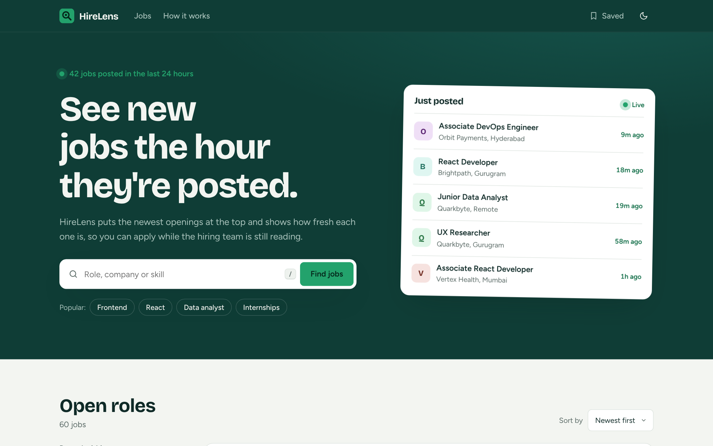

# HireLens

**Your next role. Found before everyone else.**

**Live demo:** https://hirelens-nine.vercel.app



HireLens is a fresh-first job discovery Progressive Web App for India's product companies, with a moonlit space theme. It is built with plain HTML, CSS and JavaScript modules: no framework, no build step and no runtime dependencies.

> **Note:** every company, role and salary in `data/jobs.json` is **sample data** made up for this demo. None of it is a real job posting, and nothing in the app is live. The "Apply now" button says so instead of linking anywhere.

## Features

### Discovery
- Newest jobs first, with a freshness bar and *New* / *Today* pills on every row
- Search that waits 250 ms after you stop typing and matches every word across title, company, location and skills
- Filters for location, job type, department and posted within (3h / 24h / 7d), plus sorting by newest or highest pay
- **Dual-thumb pay slider** (₹0 to ₹75+ LPA). Internship stipends are converted to a yearly figure so they filter correctly
- **Toggle chips** for Full-time, Internship, Contract and Remote
- **Skill matcher:** add up to 5 of your skills and matching tags are highlighted on every listing and in the job drawer. Each job shows a badge with the share of its listed skills you have, for example "75% match"
- Active filters are removable chips and live in the URL, so any view can be shared as a link
- Infinite scroll in pages of 10, skeleton loaders, an error state with *Try again*, and an empty state with *Clear filters*

### Job details and comparison
- **Job drawer** that slides in from the right (full width on phones) with a pay breakdown per year and per month, skills and level, and a sticky Apply / Save bar
- **Compare drawer:** shortlist up to 3 jobs and see pay, level, type, location and skills side by side in a bottom drawer
- Deep links: `?job=<id>` opens that job on a cold load, and *Copy link* copies the full URL
- Recently viewed strip and a "new since your last visit" banner

### Saved jobs
- Stored in IndexedDB with a localStorage fallback, with an instant UI update and rollback if a write fails
- Live saved counter in the nav and a saved-only view
- Works offline through a service worker

### Look and feel
- **Moonlight theme:** deep space navy, silver-blue accents, a glowing moon and a twinkling starfield that drifts gently with scroll and pointer movement
- **Accent picker:** Moonlight, Electric Blue, Cyber Neon Green, Warm Amber and Deep Violet, in both dark and light themes. Your choice is remembered
- Dark by default, with a light theme and a smooth toggle. Your choice is remembered
- Frosted glass job cards. Jobs posted in the last 3 hours get a gradient border and a soft glow
- Glass navigation bar that becomes more opaque on scroll, with animated link underlines
- Staggered headline reveal and a "Just in" marquee built from the sample jobs (pauses on hover)
- Pulsing live dots next to the *Live* and *Just posted* labels
- Animated list changes, spring-like dialogs, toasts with undo, and shimmer skeletons
- Reduced motion is respected everywhere: the stars stop moving, the marquee stops and animations become instant

### Keyboard and feedback
- **Command palette** with ⌘K / Ctrl K: fuzzy search over every job, arrow keys to move, Enter to open, ⌘S / Ctrl S to save the highlighted job
- Keyboard-first list: `j` / `k` move between rows, `Enter` opens, `s` saves
- **Sound and haptics** (off by default): a soft pop when you save a job and a quiet tick when filters change, plus a short vibration on phones. Toggle it with the speaker button in the nav

## Keyboard shortcuts

| Key | Action |
| --- | --- |
| `⌘K` / `Ctrl K` | Command palette |
| `↑` / `↓` | Move through palette results |
| `Enter` | Open the highlighted result |
| `⌘S` / `Ctrl S` | Save the highlighted job (inside the palette) |
| `/` | Focus search |
| `j` / `k` | Next / previous job |
| `s` | Save or unsave the focused job |
| `t` | Toggle theme |
| `x` | Clear filters |
| `v` | Show saved jobs |
| `p` / `n` | Sort by pay / newest |
| `l` | Copy link to this view |
| `?` | Shortcut sheet |
| `Esc` | Close any dialog |

## Tech stack

- HTML5 with native `<dialog>`, landmarks and ARIA
- CSS custom properties, `color-mix()`, Grid, Flexbox, `backdrop-filter` and View Transitions
- JavaScript ES modules with no third-party code
- IndexedDB, localStorage, sessionStorage and the Web Audio API
- Service Worker and Web App Manifest
- `node:test` for unit tests

## Project structure

```
hirelens/
├── index.html              App shell, dialogs and the SVG icon sprite
├── css/
│   ├── styles.css          Base design system, components, responsive rules
│   └── midnight.css        Moonlight theme, starfield, accents, glass cards, slider, drawer
├── js/
│   ├── main.js             State, rendering, filters, dialogs, palette, keyboard, toasts
│   ├── enhance.js          Nav glass state, headline reveal, live strip, accent picker, star motion, sound, skill matcher
│   ├── store.js            Tiny observable store plus safe storage helpers
│   ├── db.js               Saved jobs in IndexedDB with a localStorage fallback
│   ├── render.js           HTML templates, with every dynamic value escaped
│   └── utils.js            Pure, unit-tested helpers (filtering, pay ranges, time, URL, fuzzy match)
├── sw.js                   Versioned caches: cache-first shell, stale-while-revalidate data
├── manifest.webmanifest
├── data/jobs.json          60 sample jobs
├── assets/                 Icon, preview image and self-hosted fonts
├── tests/utils.test.js     12 unit tests
├── package.json
├── LICENSE
└── README.md
```

## Run locally

ES modules and service workers need a real HTTP server. **Opening `index.html` directly as a `file://` URL will not work.**

```bash
npx serve .
python3 -m http.server 8000
```

Then open the printed URL, for example `http://localhost:3000` or `http://localhost:8000`.

## Tests

```bash
npm test
```

This runs 12 tests with Node's built-in test runner (Node 18 or newer). There is nothing to install.

## Deploy to GitHub Pages

1. Push this folder to your repository so `index.html` is at the root.
2. Open **Settings → Pages**.
3. Under **Build and deployment**, choose **Deploy from a branch**, then pick `main` and `/ (root)`.
4. Save. After a minute the site is live at `https://<username>.github.io/<repo>/`.

All paths are relative and the service worker is registered with a `./` scope, so the app works from a project subpath without changes. The live demo at https://hirelens-nine.vercel.app is deployed on Vercel: import the repository and deploy with no build command.

If you change any cached file, bump `VERSION` in `sw.js` so returning visitors get the new version.

## Connecting a real job source

The app reads jobs from `data/jobs.json`. To use a real source, return the same fields from your API: `id`, `title`, `company`, `department`, `location`, `type`, `level`, `salaryLPA` (a `[min, max]` pair) or `stipendK`, `skills`, `postedMinutesAgo` and `summary`. Add an `applyUrl` field and link the Apply button to it, and only show company verification if your data actually provides it.

## Fonts

Bricolage Grotesque (headings) and Figtree (body) are self-hosted from `assets/fonts/`. A metric-matched fallback stack keeps the layout stable if the files are missing.

## License

- **Code:** MIT, see [`LICENSE`](./LICENSE).
- **Fonts:** SIL Open Font License 1.1, see [`assets/fonts/OFL.txt`](./assets/fonts/OFL.txt).
- **Job data:** fictional sample data, for demonstration only.

Built by Mohit Goyal.
